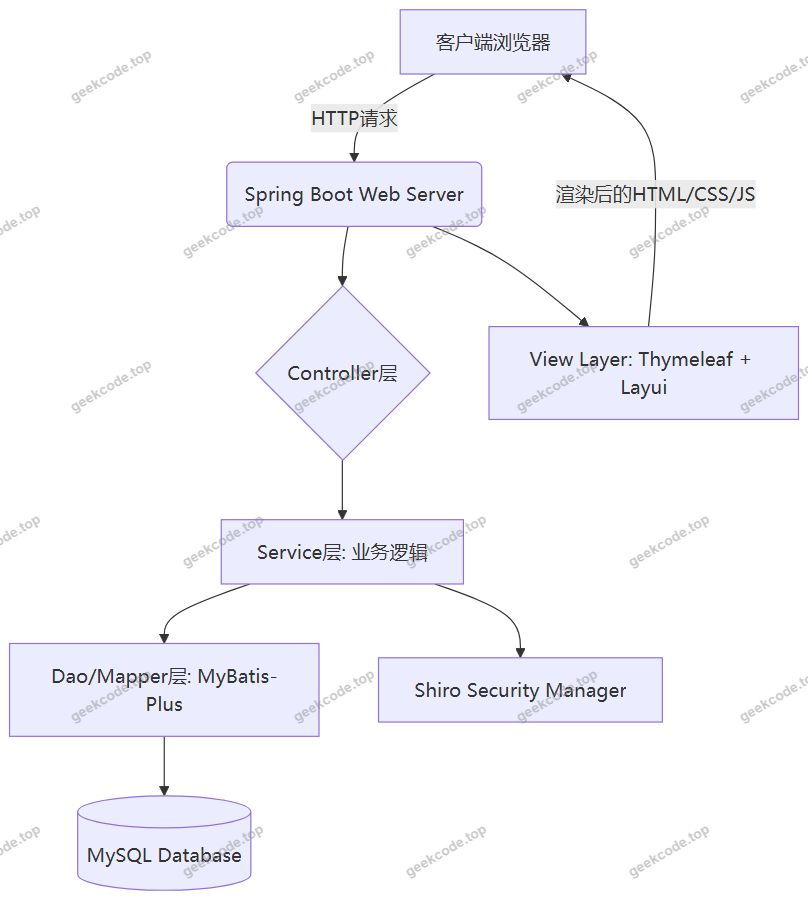
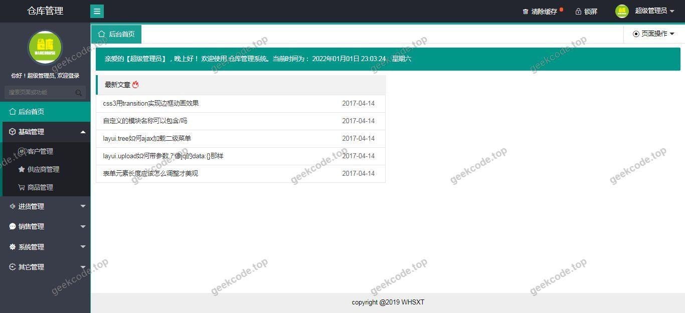
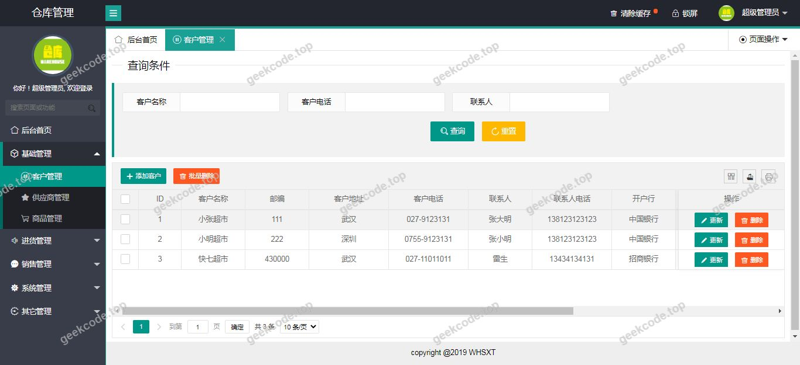
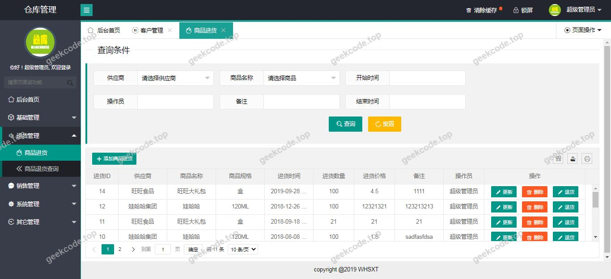
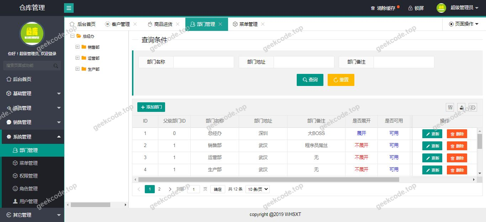
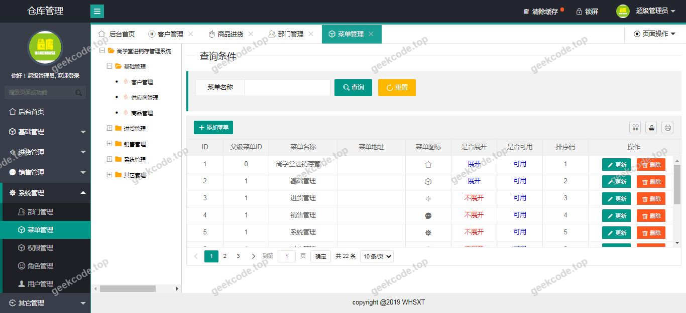
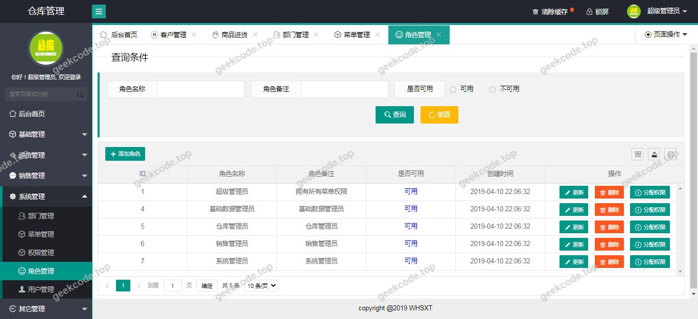
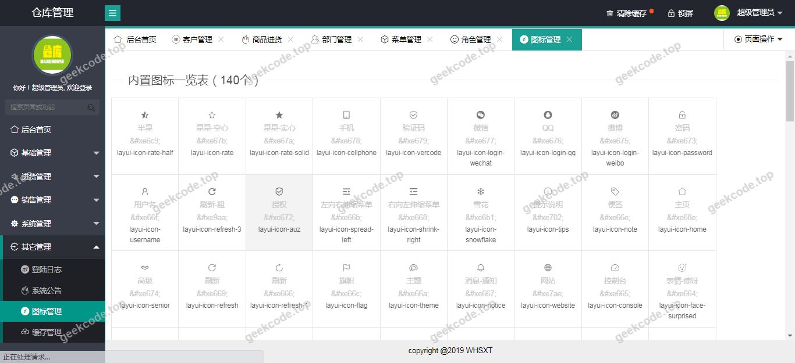

# java精品项目-基于ssm的springboot+layui仓库管理系统

> 🎓 **计算机毕业设计 · java精品项目-基于ssm的springboot+layui仓库管理系统**
>
> 本仓库只放**项目介绍 + 运行截图**（截图是站点带水印的原图，存在仓库 `images/` 里）。
>
> 👉 **完整可运行源码 / 数据库脚本 / 部署文档：[点我获取](https://geekcode.top/archives/java%E7%B2%BE%E5%93%81%E9%A1%B9%E7%9B%AE-%E5%9F%BA%E4%BA%8Essm%E7%9A%84springboot-layui%E4%BB%93%E5%BA%93%E7%AE%A1%E7%90%86%E7%B3%BB%E7%BB%9F?utm_source=github)**
>
> 💬 咨询微信：**ir9372**　|　🌐 更多项目：[极客代码 geekcode.top](https://geekcode.top/?utm_source=github)
>
> 📌 项目详情页：<https://geekcode.top/archives/java%E7%B2%BE%E5%93%81%E9%A1%B9%E7%9B%AE-%E5%9F%BA%E4%BA%8Essm%E7%9A%84springboot-layui%E4%BB%93%E5%BA%93%E7%AE%A1%E7%90%86%E7%B3%BB%E7%BB%9F?utm_source=github>

<table><td width="230" align="center"> <b>扫码加微信 ir9372</b></td><td valign="middle">📦 源码 = 项目介绍 + 全部运行截图 + 数据库 + 部署文档 👉 点上方任意截图，直接跳到 <b>极客代码 geekcode.top</b> 详情页</td></table>

---

<h1>java精品项目-基于ssm的springboot+layui仓库管理系统</h1>
<h2>项目概述</h2>

本项目为“基于SSM架构的Spring Boot与Layui仓库管理系统”，旨在解决传统仓储管理中数据录入繁琐、库存状态不透明及权限管理混乱等痛点。系统采用后端服务与前端展示分离的设计思想，通过Spring Boot构建稳定高效的后端逻辑，结合MyBatis-Plus简化数据库交互，利用Shiro实现细粒度的安全控制。前端界面基于Thymeleaf模板引擎渲染，并集成Layui框架以提升用户操作体验。该系统主要面向中小型企业或校园实验室的物资管理人员，提供基础的仓库信息维护、出入库记录管理及系统配置功能。其核心目标是构建一个轻量级、易部署且具备良好扩展性的仓库管理平台，确保数据的准确性与安全性，降低人工管理成本，提升物资流转效率。

<h2>技术架构</h2>

本系统采用经典的MVC分层架构设计，整体技术栈以Java为核心，具体架构如下：

<strong>1. 后端架构</strong>

<ul>
<li><strong>核心框架</strong>：使用 <code>Spring Boot</code> 作为基础开发框架，利用其自动配置特性快速搭建应用骨架，集成 <code>spring-boot-starter-web</code> 处理HTTP请求，<code>spring-boot-starter-aop</code> 实现日志记录与事务管理等横切关注点。</li>
<li><strong>持久层</strong>：选用 <code>MyBatis-Plus</code> 作为ORM框架，配合 <code>mysql-connector-java</code> 驱动连接MySQL数据库。MyBatis-Plus提供了通用的CRUD接口，显著减少了样板代码的开发量。同时引入 <code>Druid</code> 作为数据库连接池，提供监控功能和高性能连接管理。</li>
<li><strong>安全模块</strong>：集成 <code>Apache Shiro</code> 进行身份认证与授权管理，确保只有合法用户才能访问受保护的资源。</li>
<li><strong>视图层</strong>：使用 <code>Thymeleaf</code> 作为服务端模板引擎，负责生成HTML页面，支持静态资源与动态数据的无缝结合。</li>
<li><strong>辅助工具</strong>：引入 <code>Lombok</code> 简化实体类代码（如Getter/Setter），使用 <code>fastjson</code> 进行JSON序列化与反序列化处理。</li>
</ul>

<strong>2. 前端架构</strong>

<ul>
<li><strong>UI框架</strong>：基于 <code>Layui</code> 前端框架构建界面。Layui是一套遵循自身规范的前端UI组件库，提供了丰富的表单、表格、弹窗等组件，适合后台管理类系统的快速开发。</li>
<li><strong>交互逻辑</strong>：前端页面通过Thymeleaf嵌入后端数据，利用Layui提供的JS模块进行页面交互和数据提交。</li>
</ul>

<strong>3. 数据库设计要点</strong>

<ul>
<li>数据库选型为 MySQL，存储仓库基本信息、物资条目、出入库流水及用户权限数据。表结构设计遵循第三范式，确保数据冗余最小化。</li>
</ul>

<h2>功能模块</h2>

根据截图所示的系统运行界面，该项目主要包含以下核心功能模块。由于上下文未提供具体的后台路由定义，以下模块划分基于典型仓库管理系统及截图展示的通用界面特征进行归纳：

<strong>1. 登录与认证模块</strong>

<ul>
<li>提供用户登录入口，验证用户名和密码。</li>
<li>集成Shiro安全框架，处理会话创建、注销及权限校验。</li>
<li>界面包含验证码输入框（若存在）及登录状态反馈。</li>
</ul>

<strong>2. 首页仪表盘模块</strong>

<ul>
<li>展示系统关键指标概览，如今日入库数量、出库数量、当前库存总量等。</li>
<li>提供快捷操作入口，链接至各子功能模块。</li>
<li>显示最新通知或异常预警信息。</li>
</ul>

<strong>3. 仓库信息管理模块</strong>

<ul>
<li><strong>仓库列表</strong>：展示所有注册仓库的基本信息（名称、地址、负责人、状态）。</li>
<li><strong>新增/编辑仓库</strong>：提供表单用于录入或修改仓库详情。</li>
<li><strong>删除/停用</strong>：对无效仓库进行逻辑删除或状态变更。</li>
</ul>

<strong>4. 物资/库存管理模块</strong>

<ul>
<li><strong>物资分类</strong>：维护物资所属类别树状结构。</li>
<li><strong>库存查询</strong>：支持按名称、编号、分类等多条件检索当前库存明细。</li>
<li><strong>库存预警</strong>：当某物资低于设定阈值时，在列表中高亮显示或触发提醒。</li>
</ul>

<strong>5. 出入库业务模块</strong>

<ul>
<li><strong>入库登记</strong>：记录新采购或归还物资的信息，包括数量、批次、经办人等。</li>
<li><strong>出库登记</strong>：记录领用或发货物资的信息，关联申请人及用途。</li>
<li><strong>流水查询</strong>：查看历史出入库记录，支持导出报表。</li>
</ul>

<strong>6. 系统设置模块</strong>

<ul>
<li><strong>用户管理</strong>：添加、修改、禁用系统用户账号。</li>
<li><strong>角色管理</strong>：定义不同角色的权限集合。</li>
<li><strong>参数配置</strong>：设置系统全局参数，如默认分页大小、主题颜色等。</li>
</ul>

<em>(注：具体字段及详细操作按钮需参照实际源码中的Controller映射，此处基于标准仓库管理逻辑概括)</em>

<h2>用户角色与权限</h2>

系统基于Shiro框架实现RBAC（基于角色的访问控制）模型。虽然具体角色名称未在上下文中显式列出，但依据仓库管理系统的常规设计及安全需求，通常包含以下角色及其权限范围：

<table>
<thead>
<tr>
<th align="left">角色名称</th>
<th align="left">权限描述</th>
<th align="left">可访问功能模块</th>
</tr>
</thead>
<tbody><tr>
<td align="left"><strong>超级管理员</strong></td>
<td align="left">拥有系统最高权限，可进行所有操作，包括系统配置和用户管理。</td>
<td align="left">全部模块：首页、仓库管理、库存管理、出入库管理、系统设置（用户/角色/参数）、日志审计。</td>
</tr>
<tr>
<td align="left"><strong>仓库管理员</strong></td>
<td align="left">负责具体仓库的日常运营，可管理该仓库下的物资和单据，无权修改系统配置。</td>
<td align="left">首页、指定仓库的信息维护、物资增删改查、出入库单据审核与录入、个人密码修改。</td>
</tr>
<tr>
<td align="left"><strong>普通员工/申请人</strong></td>
<td align="left">仅能查看部分公开库存信息并提交申请，无法直接修改库存数据。</td>
<td align="left">首页、库存查询（只读）、提交出库申请、查看个人申请进度、个人密码修改。</td>
</tr>
</tbody></table>

<strong>权限控制机制：</strong>

<ul>
<li><strong>URL拦截</strong>：Shiro过滤器链对特定路径进行拦截，未登录用户重定向至登录页。</li>
<li><strong>注解鉴权</strong>：在Controller方法上使用 <code>@RequiresRoles</code> 或 <code>@RequiresPermissions</code> 注解，细化到按钮级别的权限控制。</li>
<li><strong>数据隔离</strong>：仓库管理员只能看到和操作其被分配的仓库数据，防止越权访问。</li>
</ul>
<h2>项目特色与创新点</h2>
<ol>
<li><strong>轻量化与高效性</strong>：采用 Spring Boot 与 MyBatis-Plus 组合，摒弃了传统 SSM 项目中繁重的 XML 配置文件，实现了“约定优于配置”的开发模式，大幅提升了开发效率和系统启动速度。</li>
<li><strong>前后端一体化渲染</strong>：使用 Thymeleaf 结合 Layui，避免了前后端分离架构中跨域问题及复杂的API对接调试过程，特别适合中小型内部管理系统，部署简单，维护成本低。</li>
<li><strong>健壮的安全体系</strong>：深度集成 Apache Shiro，不仅实现了基础的登录认证，还提供了灵活的授权机制和会话管理，有效防止未授权访问和会话劫持风险。</li>
<li><strong>优秀的用户体验</strong>：引入 Druid 连接池实时监控数据库性能，帮助开发者快速定位慢SQL；Layui 框架提供的现代化UI组件使得界面简洁美观，操作流畅，降低了用户的学习成本。</li>
<li><strong>代码整洁度</strong>：利用 Lombok 消除冗余代码，保持实体类清爽；AOP 切面统一处理日志与异常，使业务逻辑代码更加纯粹，便于后期维护和扩展。</li>
</ol>
<h2>部署环境</h2>

为确保系统正常运行，需准备以下软硬件环境：

<strong>1. 硬件环境</strong>

<ul>
<li>CPU：双核及以上</li>
<li>内存：4GB 及以上</li>
<li>硬盘：至少 20GB 可用空间</li>
</ul>

<strong>2. 软件环境</strong>

<ul>
<li><strong>操作系统</strong>：Windows 7/10/11, Linux (CentOS 7+, Ubuntu 18.04+), macOS</li>
<li><strong>JDK版本</strong>：Java Development Kit 1.8 或更高版本（推荐 JDK 1.8，兼容性好）</li>
<li><strong>数据库</strong>：MySQL 5.7 或 MySQL 8.0</li>
<li>需安装 MySQL Server 并创建对应的数据库实例。</li>
<li>建议字符集设置为 <code>utf8mb4</code> 以支持完整Unicode字符。</li>
<li><strong>构建工具</strong>：Maven 3.6+ （用于依赖管理和项目打包）</li>
<li><strong>Web服务器</strong>：内置 Tomcat（由 Spring Boot Starter Web 提供，无需单独安装外部Tomcat）</li>
<li><strong>浏览器</strong>：Chrome, Firefox, Edge 等现代浏览器（IE兼容性较差，不建议使用）</li>
</ul>

<strong>3. 部署步骤简述</strong>

<ol>
<li>导入项目源码至 IDE（如 IntelliJ IDEA 或 Eclipse）。</li>
<li>配置 <code>application.yml</code> 或 <code>application.properties</code> 中的数据库连接信息（URL, Username, Password）。</li>
<li>执行 Maven 命令 <code>mvn clean package</code> 生成 JAR 包。</li>
<li>在服务器上安装 JDK 和 MySQL，初始化数据库脚本。</li>
<li>运行 JAR 包：<code>java -jar project-name.jar</code>。</li>
<li>通过浏览器访问 <code>http://localhost:8080</code>（端口号视配置而定）进入系统。</li>
</ol>
<h2>五、技术特性</h2>
<ul>
<li>使用 MyBatis-Plus 简化数据访问层开发</li>
<li>集成 Shiro 权限框架实现角色权限控制</li>
</ul>
<h2>六、功能模块截图</h2>
<h3>前台用户端</h3>
<h4>系统运行界面1</h4>

<h4>系统运行界面2</h4>

<h4>系统运行界面3</h4>

<h4>系统运行界面4</h4>

<h4>系统运行界面5</h4>

<h4>系统运行界面6</h4>

<h4>系统运行界面7</h4>

<h4>系统运行界面8</h4>

---

## 获取完整源码

| 项目 | 说明 |
| --- | --- |
| 项目名 | java精品项目-基于ssm的springboot+layui仓库管理系统 |
| 运行截图 | 本文 9 张（站点带水印原图，仓库 `images/` 目录） |
| 完整源码 | [https://geekcode.top/archives/java%E7%B2%BE%E5%93%81%E9%A1%B9%E7%9B%AE-%E5%9F%BA%E4%BA%8Essm%E7%9A%84springboot-layui%E4%BB%93%E5%BA%93%E7%AE%A1%E7%90%86%E7%B3%BB%E7%BB%9F?utm_source=github](https://geekcode.top/archives/java%E7%B2%BE%E5%93%81%E9%A1%B9%E7%9B%AE-%E5%9F%BA%E4%BA%8Essm%E7%9A%84springboot-layui%E4%BB%93%E5%BA%93%E7%AE%A1%E7%90%86%E7%B3%BB%E7%BB%9F?utm_source=github) |
| 咨询微信 | **ir9372**（备注：jingpin-yuanma） |
| 更多项目 | [极客代码 geekcode.top](https://geekcode.top/?utm_source=github) |

> 需要源码、部署、改配置、跑不起来等问题，加微信 ir9372 沟通，说明项目名即可。
